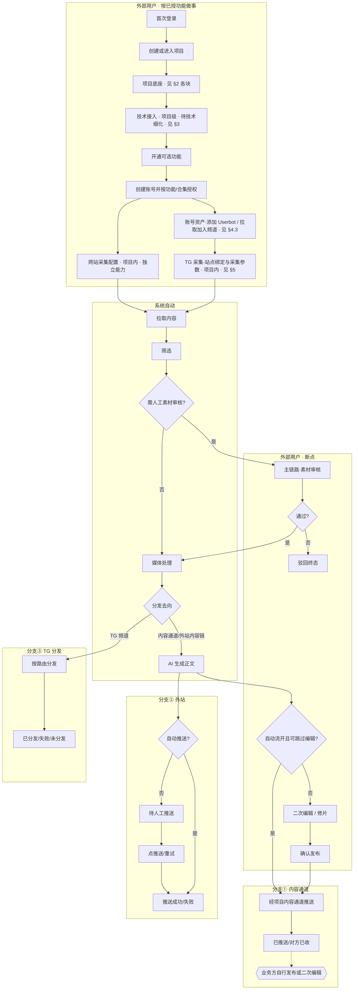
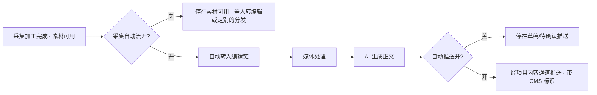
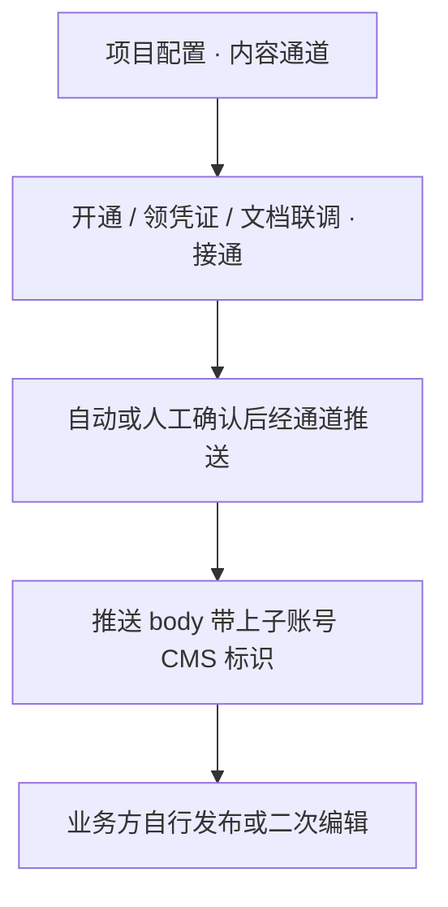
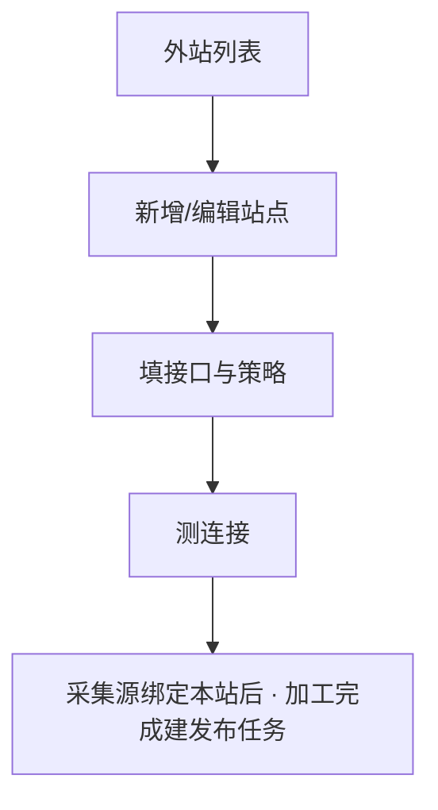
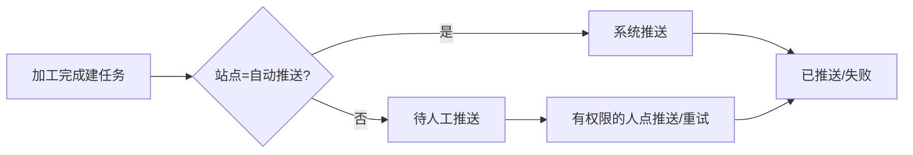
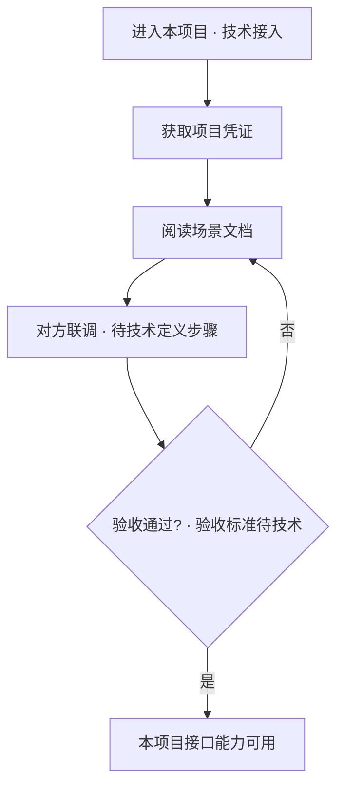
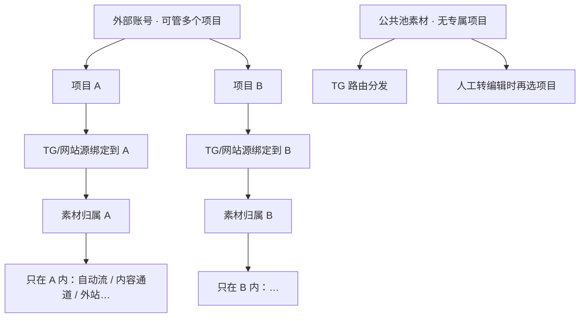
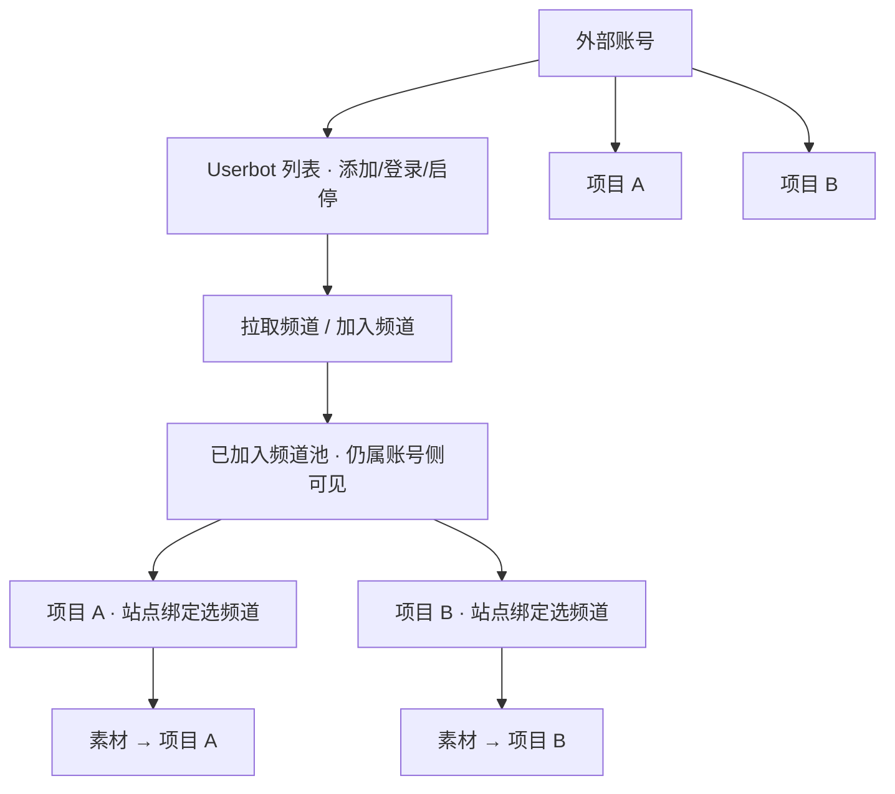
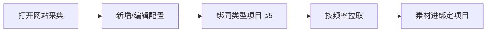
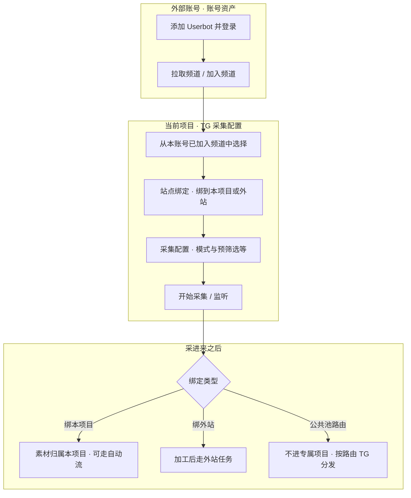

# 方舟 · To-Be 主流程泳道图（首次接入 → 三条分发）

> 版本：v0.5 · 2026-10-26  
> 对应：`方舟-To-Be信息架构与权限草案.md` **v0.9.3+**  
> 范围：外部用户首次登录 → 项目与底座 → **技术接入（待技术细化）** → 授功能 → **网站采集 / TG 采集（两个独立能力）** → 筛选 / 人审 / 媒体 / **AI** → 内容通道 / 外站 / TG  
> **v0.5**：内容通道替代多 CMS 账号；删跑马灯 / 前台地址；AI 评论须补评论预览债务  
> **v0.4**：**Userbot 与加频道改挂外部账号（账号资产）**；绑项目/采集参数仍挂项目；方舟 Admin 不再代配 bot

---

## 约定

| 标记 | 含义 |
| --- | --- |
| 单页配置块 | 下列出**要填的字段**（来自现网，To-Be 可改名但不丢能力） |
| 流程集合块 | 用**子流程图**展开 |
| `待技术` | 产品已占位，接口/步骤由技术评估后回填 |
| AI 节点 | 必须单独画出 |

前置：无。Userbot 由外部账号自己加（见 §4.3、§5.2）。

---

## 1. 总图（首次接入主线）

**自动流在总图里管什么（先说清楚）：**  
「采集自动流」不是很多条互不相关的流，而是**专属站内容链上的两段开关合称**：

1. 采集加工完成 → **是否自动转入编辑（生成文章）**  
2. 转入后 → **是否经项目内容通道自动推送**（跳过人工二次编辑；推送带上操作子账号的「CMS 标识」，由接收方判归属）

关自动流：人要在素材侧「转编辑」或在文章侧确认推送。  
开自动流：筛选/媒体/AI 之后可直达内容通道推送（失败仍进待办）。  
**方舟不做多 CMS 账号分发**；业务方收到后自行发布/二次编辑。  
**TG 分发、外站推送**另有自己的策略，不都叫「采集自动流」。

---

## 2. 项目底座 · 分块说明

底座 = 项目级、相对稳定、决定「这条内容链怎么跑」的配置。  
下面每块：要么是**单页字段表**，要么是**子流程**。

### 2.1 基本信息与自动流（单页配置）

| 字段（To-Be 已定） | 必填 | 说明 |
| --- | --- | --- |
| 项目名称 | * | 展示名 |
| 项目标识 / 采集号等 | * | 项目身份字段（不以「对方 CMS 账号」为主路径） |
| 封面尺寸 | | 生成/推送用封面规格 |
| **采集自动流 · 开关** | | 开：采集完成 → 自动转编辑 +（可）经内容通道自动推送 |
| **内容通道自动推送** | 开自动推送时 * | 走本项目唯一内容通道；推送带上子账号「CMS 标识」 |

**已删除（勿再出现）**：**跑马灯**、**前台地址 / 前台站点地址**（原服务于 AI 评论预览）。**多用户 CMS 账号**已废弃 → 见 §2.4 内容通道。

> 水印与基本信息拆开；To-Be **拆到 §2.2**，本页专注身份 + 自动流。

#### 自动流 · 运行子流程（打开时系统怎么走）

**本块只配开关与通道意向；真正的媒体 / AI / 推送是系统步骤，见总图。**

---

### 2.2 水印（单页配置）

| 字段（现网口径） | 说明 |
| --- | --- |
| 图片水印 | 位置/样式等 |
| 视频固定水印 | |
| 视频四角循环水印 | |
| 移动水印 | |
| （与封面尺寸的关系） | 封面尺寸若仍放基本信息，此处不重复 |

性质：表单配置，**不是**一套独立业务流程。效果由媒体处理阶段消费。

---

### 2.3 文章模板（单页配置）

| 内容 | 说明 |
| --- | --- |
| 模板内容 / 结构 | 现网「文章模板」弹窗；管生成或排版用的模板 |
| 与项目绑定 | 一项目可配自己的模板 |

性质：单页配置。被 **AI 生成正文** 步骤使用。

---

### 2.4 内容通道（项目级 · 替代原「CMS 账号」）

**已定**：一个项目 = **一套**文章内容通道。方舟**不做**「多 CMS 账号再按账号分发」。

| 对象 | 说明 |
| --- | --- |
| **项目内容通道** | 项目级一套；凭证只读展示 + 复制；接通后自动流/推送才真正生效 |
| **子账号 CMS 标识** | 对方后台复制的 ID；推送时统一携带，由接收方判断内容归属 |
| **禁止** | 录入对方 CMS 账号密码、维护多套 CMS 登录账号再选账号发布 |

互动可选能力（AI 评论等）挂项目可选包，**不**再挂在「CMS 账号」上。  
**产品债务**：做「AI 评论」时必须补「评论预览」（前台地址预览已删，否则能力不完整）。

---

### 2.5 外站发布对接（列表 + 表单；策略决定分支②怎么走）

#### 配置流

#### 单个站点主要字段（现网摘要）

| 分组 | 字段 |
| --- | --- |
| 基础 | 代码、名称*、接口地址*、前缀、签名密钥、启用 |
| 推送策略 | **自动推送** vs **内容就绪待人工确认** |
| 媒体 | 是否必须含视频 |
| 内容 | ~~站点手选 AI/原文/不生成~~ → To-Be 按分发去向自动（见总图 S6；融合口径 §3） |
| 水印（外站侧） | 去源水印+logo、固定/四角/移动、宽比等 |
| 其它 | 切片 m3u8、分集推送、封面比例；~~对方分类项目固定~~ → 待技术；推送即发布、附加 JSON 等 |

#### 配完后任务怎么走（分支②细化）

---

## 3. 技术接入（项目级 · 重要 · 待技术评估）

> 产品占位：每个项目除「填表配置」外，还应能按**开发文档**做接口级接入（对方系统调方舟 / 方舟回调对方）。  
> **怎么鉴权、要哪些接口、沙箱怎么验、和「外站站点配置」「接入向导」如何分工 → 待技术评估后回填本节点。**

### 3.1 在总流程中的位置

放在 **项目底座基本配齐之后、大规模授号与采量之前**（总图 A4）。  
也可与底座并行，但必须挂在**项目**下，而不是只有平台级文档。

### 3.2 产品期望具备的能力（待技术拆成可交付步骤）

| 期望 | 说明 |
| --- | --- |
| 项目级凭证 | 如 AppId / Secret，可轮换；与项目绑定 |
| 开发文档入口 | 按场景：外站推送、评论审核回调、内容查询等 |
| 联调 / 沙箱 | 调用日志、签名校验结果可自助看 |
| 与表单配置的关系 | 表单解决「业务参数」；技术接入解决「对方工程师如何调通」 |

### 3.3 占位子流程（技术细化前仅作示意）

**本版本不编造具体 API 列表或联调步骤。** 技术评估结论回来后，替换 §3.3 并更新总图 A4 出站条件。

---

## 4. 账号 · 项目 · 采集 · 分发 · 关系（先钉模型）

你的担心对：**如果采集挂在「账号」、分发挂在「项目」，中间一定多一层「再分配」**，心智和产品都会变重。  
现网其实**不是**「账号采一坨、再分给名下所有项目」，而是两套模式并存：

| 模式 | 内容归谁 | 怎么进项目 / 怎么发出去 | 和「一账号多项目」 |
| --- | --- | --- | --- |
| **专属站（主路径 · 少操作）** | **进项目时就定归属** | 频道/网站**绑定到某个项目** → 素材带项目归属 → 自动流转编辑/经内容通道推送 | 账号只是「有权管哪些项目」；**每个项目各自绑自己的源** |
| **公共池 + 路由** | 先落**公共池**（无专属项目） | TG **路由**一源多目标分发；要进内容通道常要**人工选项目**再转编辑（不再选 CMS 账号） | 更像「账号/平台级料池 → 再分到项目」，负担重 |

### 4.1 建议默认（已按此写）

1. **素材归属 = 项目。** 网站采集、TG「绑到本项目」都在项目上下文；料进该项目。  
2. **一账号多项目** = 权限范围，**不是**账号级共享料池。  
3. **Userbot + 拉取/加入频道 = 账号资产**（跟账号走，不跟单个项目走）。  
4. **站点绑定 + 频道采集参数 = 项目配置**（跟项目走）。  
5. 外站对接挂项目；公共池/路由仍作例外模式。

### 4.2 对象关系一句话

| 对象 | 挂在哪 | 是什么 |
| --- | --- | --- |
| 账号 | — | 人；功能授权；**名下 Userbot 列表** |
| Userbot | **账号** | TG 登录会话；可被名下多个项目选用 |
| 拉取/加入频道 | **账号**（在某个 Userbot 上操作） | bot 进群；还不算进哪个项目 |
| 项目 | 账号可管多个 | 底座、内容通道、外站、**绑定与采集参数**、素材归属 |
| 网站采集配置 | **项目** | 爬站采源 |
| TG 站点绑定 / 采集参数 | **项目** | 选账号下已有频道 → 绑本项目 → 怎么采 |
| 外站对接 | **项目** | 出口 |
| 公共池/路由 | 例外 | 非专属默认 |

### 4.3 Userbot 跟账号还是跟项目？（结论：跟账号）

| 方案 | 做法 | 问题 |
| --- | --- | --- |
| 挂项目 | 每个项目各自加 bot、加频道 | 同一手机号多项目要重复登录；项目之间无法复用 bot |
| **挂账号（采用）** | 账号下维护 bot；加频道一次；各项目再绑定 | 多项目可共用一个 bot；隔离靠「绑定到哪个项目」而不是靠重复养号 |
| 挂方舟 Admin | 平台代配 | 与「业务自己接入」不符，已放弃作默认 |

**一句话**：养号、进群跟**账号**；「这个频道的料进谁」跟**项目**。

---

## 5. 两种采集能力（必须拆开）

| | 网站采集配置 | TG 采集配置 |
| --- | --- | --- |
| 能力 | 独立功能，单独授权 | 独立功能，单独授权 |
| 采什么 | 网页链接按频率拉 | Telegram 频道/会话消息 |
| 前置 | 无平台 bot | 方舟 Admin 已备好 Userbot，且 bot 已进目标频道 |
| 绑定 | 配置绑**同类型项目**（瓜/视频/短剧均可，≤5；承接原外站多选） | **站点绑定**到当前项目；与公共池路由二选一逻辑见下 |
| 复杂度 | 中：列表+表单 | 高：bot → 加频道 → 绑定 → 采集参数 → 开监听 |

总图里是两条并行入口，不是一个「采集配置」菜单糊在一起。

### 5.1 网站采集配置（单页/列表 · 项目内）

**流程**

**字段（To-Be）**

| 字段 | 说明 |
| --- | --- |
| 站点名*、主域名*、类型* | 类型：瓜 / 视频 / 短剧；创建后不可改 |
| 网页链接* | 可多条，上限 50；同一页面不可进两条配置 |
| 启动采集、判重、频率 | 30 分～每天等；启停与配置状态机分开 |
| 绑定项目 | 同类型项目多选 ≤5（承接现网外站多选） |
| 备注 | |

---

### 5.2 TG 相关（拆成「账号资产」+「项目采集」）

现网「频道管理」一页揉了养号、进群、绑定、路由。To-Be 拆开：

| 能力 | 挂载 | 菜单建议 |
| --- | --- | --- |
| Userbot 管理、拉取/加入频道 | **账号** | 账号资产 / Telegram 账号（需功能授权） |
| 站点绑定、采集参数、开监听 | **项目** | TG 采集配置（项目内） |
| 公共池路由 | 例外，可仍偏平台或账号高级 | 与专属绑定分开 |

#### 5.2.1 端到端流程

> 专属站 vs 外站绑定二选一（现网）；专属站料不进 TG 路由。公共池才上路由。

#### 5.2.2 子步骤与字段

**A. 账号资产 · Userbot（跟账号走）**

| 步骤 | 字段/动作（现网） |
| --- | --- |
| 添加 Userbot | 快捷：标签+手机发码；或高级：API ID/Hash → 验证码 → 两步密码 |
| 连接 / 断开 / 删除 | |
| 拉取频道 / 加入新频道 | t.me / @ / 邀请链接 |
| 谁可操作 | 授了「Userbot 管理」的外部账号（开户主账号默认有） |

**B. 项目内 · 站点绑定（跟项目走 · 决定归属）**

| 字段/动作 | 说明 |
| --- | --- |
| 选中频道 | 来自**本账号**下 Userbot 已加入列表 |
| 绑定目标 | **本项目** 或 **外站**（二选一） |
| 判重 | 可关 |
| 即时保存 | 未采频道选站后可自动变为采集 |

**C. 项目内 · 频道采集配置（怎么采）**

| 字段（现网） | 说明 |
| --- | --- |
| 采集模式 | 直接消息 / 评论区 / 文件机器人 |
| 快速转发 + 目标频道 | 旁路 |
| 预筛选 | 浏览量、互动、关键词、匹配模式 |
| 历史扫描 | 条数、浏览、互动、开始扫描 |

**D. 监听开关（项目或账号侧触发，作用在已绑定关系上）**

| 动作 | 说明 |
| --- | --- |
| 开始采集 / 停止 | Monitor；bot 须在源频道内 |

**E. 公共池 · 新建路由（例外，勿与专属绑定混菜单）**

| 字段 | 说明 |
| --- | --- |
| 一源 → N 目标 | TG 分发；bot 须在源与目标 |

#### 5.2.3 和「多项目」合在一起怎么理解

- 账号养 1 个 Userbot、加好频道。  
- 项目 A 绑定频道 X → 料进 A；项目 B 绑定频道 Y → 料进 B。  
- 同一频道是否允许同时绑 A 和 B：待拍板（现网偏专属一对一）。  
- **不是**：账号采完料，A、B 自动共用料池。

---

## 6. 三条分支对照（总图放大）

| 分支 | 依赖底座 | AI | 人工断点 | 终点 |
| --- | --- | --- | --- | --- |
| ① 内容通道 | 项目级内容通道接通 +（可选）自动流；推送带 CMS 标识 | AI 生成正文 | 自动流关 → 编辑确认 | 已推送；业务方自行发布/二次编辑 |
| ② 外站 | 外站发布对接 | 视站点「是否 AI 生成」 | 非自动推送 → 待推送 | 已推送/失败 |
| ③ TG | 平台路由 + 项目/公共池策略 | **不经** AI 生成正文 | 未分发/失败 | 已分发/失败 |

---

## 7. 刻意不画细

- 互动可选能力（AI 评论、帖子、用户审等）——其中 **AI 评论后续必须补「评论预览」**（前台地址已删，否则能力不完整；侧栏 stub 须明示本债务）  
- 修片页内交互  
- 技术接入的真实接口清单（等评估）  
- Userbot 发码登录逐步截图（平台运维手册级）  

---

## 8. 待你拍板（关系模型）

1. ~~采源绑项目、料进项目~~ → **已按此默认**  
2. ~~Userbot / 加频道挂账号还是挂项目~~ → **已定：挂账号**；绑定与采集参数挂项目  
3. 是否保留**公共池 + 路由**？  
4. 同一 TG 频道是否允许绑定多个项目？  
5. 方舟 Admin 是否仍保留「代管/排查 Userbot」后门？（建议保留排障，不做日常配置主路径）

---

## 修订

| 版本 | 日期 | 说明 |
| --- | --- | --- |
| v0.1 | 2026-10-15 | 首版；对齐草案 v0.7 分角色泳道 |
| v0.2 | 2026-10-15 | 对齐 v0.8；技术接入占位；底座字段/自动流子流程 |
| v0.3 | 2026-10-15 | 账号·项目·采集·分发关系；网站/TG 拆两能力；TG 展开 |
| v0.4 | 2026-10-15 | Userbot+加频道改挂**账号资产**；项目侧只做绑定与采集参数 |
| v0.5 | 2026-10-26 | 内容通道替代 CMS 账号；删跑马灯/前台地址；AI 评论预览债务 |
